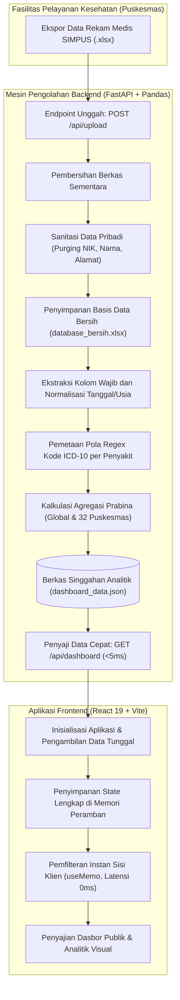
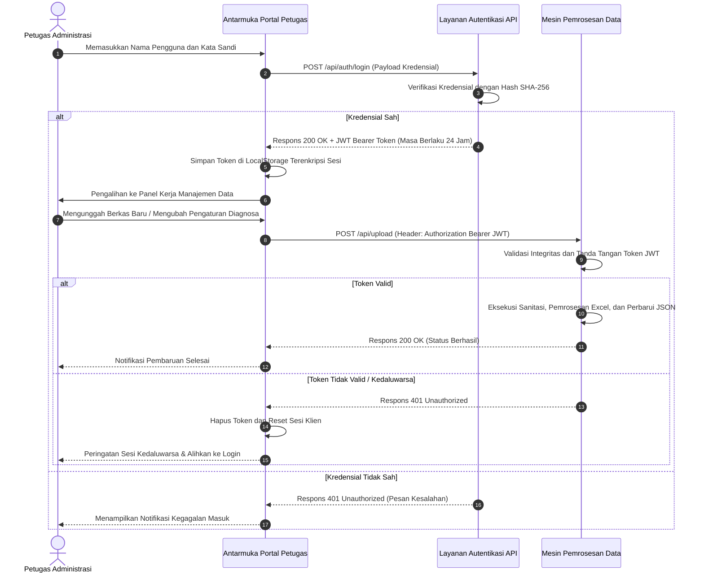

<div align="center">

# Sistem Informasi Surveilans Epidemiologi

**Platform Analitik Pemantauan Morbiditas Terpadu Fasilitas Pelayanan Kesehatan**

<p align="center">
  <a href="LICENSE"></a>
  <a href="https://react.dev/"></a>
  <a href="https://vitejs.dev/"></a>
  <a href="https://tailwindcss.com/"></a>
  <a href="https://recharts.org/"></a>
  <a href="https://fastapi.tiangolo.com/"></a>
  <a href="https://www.python.org/"></a>
  <a href="https://jwt.io/"></a>
</p>

<p align="center">
  Platform analitik kesehatan masyarakat berbasis web yang dirancang untuk mengintegrasikan, memproses, dan memvisualisasikan data rekam medis elektronik dari jaringan fasilitas kesehatan tingkat pertama (Puskesmas) secara <i>real-time</i> berbasis standar klasifikasi penyakit internasional (ICD-10) dengan pemrosesan data berlatensi nol dan otorisasi keamanan terpusat.
</p>

</div>

---

## Daftar Isi

- [Arsitektur Sistem](#arsitektur-sistem)
- [Diagram Alur Kerja](#diagram-alur-kerja)
  - [1. Alur Pemrosesan dan Agregasi Data](#1-alur-pemrosesan-dan-agregasi-data)
  - [2. Alur Autentikasi dan Keamanan Akses](#2-alur-autentikasi-dan-keamanan-akses)
- [Fungsionalitas Utama](#fungsionalitas-utama)
  - [Dasbor Publik](#dasbor-publik)
  - [Panel Manajemen Petugas](#panel-manajemen-petugas)
- [Keamanan dan Kepatuhan Privasi](#keamanan-dan-kepatuhan-privasi)
- [Spesifikasi Berkas Sumber Data](#spesifikasi-berkas-sumber-data)
- [Tumpukan Teknologi](#tumpukan-teknologi)
- [Petunjuk Pemasangan dan Operasional](#petunjuk-pemasangan-dan-operasional)
- [Konfigurasi Lingkungan](#konfigurasi-lingkungan)
- [Membangun aplikasi Android](#6-membangun-aplikasi-android)
- [Kredensial Akses Standar](#kredensial-akses-standar)

---

## Arsitektur Sistem

### Cakupan repository GitHub

Repository ini menyimpan frontend website: kode React, aset publik, konfigurasi Vite/Vercel, serta dependensi npm. Aturan [.gitignore](./.gitignore) mengecualikan proyek Android, backend FastAPI, Google Apps Script, environment lokal, kunci signing, dan hasil build. Berkas lokal tersebut tetap dapat digunakan pada komputer pengembang, tetapi tidak tersedia saat repository di-clone.

Untuk menjalankan website dari clone baru, gunakan `npm ci`, salin [.env.example](./.env.example) menjadi `.env`, isi `VITE_API_URL` dengan URL HTTPS backend yang sudah berjalan, lalu jalankan `npm run dev` atau `npm run build`. Pada hosting, isi variabel yang sama melalui pengaturan environment hosting. Backend tetap diperlukan untuk login dan data; mengunggah frontend saja tidak menjalankan backend.

Perintah Android dan petunjuk backend di dokumen ini berlaku untuk lingkungan pengembang yang memiliki berkas lokal tersebut. Script Android masih tersedia dalam [package.json](./package.json) agar pengembangan lokal tetap dapat dilakukan. Cadangkan proyek Android dan kunci signing secara terpisah karena repository frontend ini tidak menyimpannya.

Jika berkas backend pernah di-commit, `git rm --cached` hanya menghapusnya dari snapshot commit berikutnya; isi commit terdahulu tetap ada dalam riwayat Git.

Aplikasi ini mengadopsi arsitektur *Decoupled Client-Server* dengan pemisahan tegas antara logika analitik backend dan lapisan penyajian frontend:

1. **Lapisan Penyajian (Frontend):** Dikembangkan menggunakan React 19 dan Vite, mengimplementasikan sistem desain modern berbasis Tailwind CSS, tipografi *Plus Jakarta Sans*, dan pustaka grafis Recharts. Lapisan ini memanfaatkan teknik komputasi sisi klien (*in-memory state management*) untuk menghasilkan pemfilteran data berlatensi nol.
2. **Lapisan Layanan Data (Backend):** Layanan RESTful berbasis FastAPI (Python) yang menjalankan pipeline sanitasi data otomatis, pemetaan regex ICD-10 dengan Pandas, serta penyediaan data agregat melalui format JSON terstruktur berkinerja tinggi.

---

## Diagram Alur Kerja

### 1. Alur Pemrosesan dan Agregasi Data

Bagan di bawah menggambarkan siklus transformasi data mulai dari berkas rekam medis fasilitas kesehatan hingga penyajian analitik pada antarmuka pengguna:



---

### 2. Alur Autentikasi dan Keamanan Akses

Bagan urutan berikut menunjukkan mekanisme pengamanan rute administratif menggunakan verifikasi kredensial terpusat dan token berbasis tanda tangan digital (*JSON Web Token*):



---

## Fungsionalitas Utama

### Dasbor Publik

- **Pemfilteran Wilayah Instan Tanpa Beban Server (*Zero-Lag Filtering*):** Seluruh data agregat tingkat wilayah (kabupaten/kota) maupun tingkat fasilitas kesehatan spesifik telah dikalkulasi di muka pada saat proses pengunggahan. Pemilihan fasilitas kesehatan pada menu tarik-turun (*dropdown*) berlangsung dalam latensi 0 milidetik tanpa memicu permintaan HTTP berulang.
- **Ringkasan Eksekutif Terukur:** Menyajikan parameter makro meliputi total akumulasi kasus terpantau, kategori penyakit dengan insidensi tertinggi, fasilitas kesehatan dengan volume kasus terbesar, serta rasio demografi gender.
- **Papan Peringkat Beban Fasilitas Kesehatan:** Menampilkan peringkat fasilitas kesehatan berdasarkan jumlah kasus diagnosa aktif secara proporsional.
- **Kurva Tren Temporal:** Visualisasi perkembangan kasus harian menggunakan grafik area bergradien halus dengan penanda interaktif tanggal dan volume kasus baru.
- **Stratifikasi Demografi Usia:** Pengelompokan penderita menurut rentang usia standar epidemiologi: Balita (0–1 Tahun), Batita/Pra-sekolah (1–5 Tahun), Usia Sekolah/Remaja (5–18 Tahun), Usia Produktif (18–59 Tahun), dan Lanjut Usia (>60 Tahun).
- **Harmonisasi Skema Warna:** Sistem warna visual penyakit ditentukan melalui konfigurasi administratif dan diintegrasikan secara kontekstual pada elemen grafik tanpa menimbulkan kontras yang mengaburkan informasi.

### Panel Manajemen Petugas

- **Struktur Kerja Berbasis Panel Samping (*Sidebar Workspace*):** Tata kelola antarmuka administratif modern yang responsif untuk berbagai resolusi layar.
- **Modul Impor Berkas Rekam Medis:**
  - Menerima berkas spreadsheet Excel berformat multi-sheet (satu sheet untuk setiap fasilitas kesehatan).
  - Dilengkapi zona seret-lepas (*drag-and-drop*), indikator volume berkas, dan kartu referensi spesifikasi kolom wajib.
- **Manajemen Master Diagnosa dan Kodifikasi ICD-10:**
  - Tabel master data komprehensif yang menampilkan nama diagnosa, daftar kode ICD-10, indikator visual warna, dan **jumlah kasus riil yang teridentifikasi** secara aktual dari basis data.
  - Editor interaktif berbasis *chip badge* untuk penambahan dan penghapusan kode ICD-10.
  - Integrasi templat standar Sistem Kewaspadaan Dini dan Respon (SKDR) Kementerian Kesehatan RI (ISPA, Diare Akut, Tuberkulosis, Demam Berdarah Dengue, Hipertensi, dan Diabetes Melitus).
- **Kustomisasi Identitas Instansi:**
  - Konfigurasi judul dasbor, nama instansi pengelola, serta sumber data resmi.
  - Pilihan simbol medis terstandar atau opsi pengunggahan logo kustom instansi (PNG, JPG, SVG) yang disertai pratinjau langsung (*live preview*).

---

## Keamanan dan Kepatuhan Privasi

Platform ini dibangun dengan mematuhi prinsip dasar perlindungan kerahasiaan medis dan regulasi pelindungan data pribadi:

1. **Sanitasi Data Medis Sisi Server (*Data Sanitization*):**
   Setiap berkas rekam medis yang diunggah diproses melalui fungsi isolasi kolom sensitif. Atribut identitas langsung pasien—termasuk Nomor Induk Kependudukan (NIK), Nama Lengkap, Nomor Rekam Medis personal, dan Alamat Domisili—secara permanen dieliminasi sebelum disimpan ke dalam penyimpanan server.
2. **Otorisasi Rute Administratif Berbasis Token (JWT):**
   Seluruh operasi perubahan data, konfigurasi diagnosa, dan pembaruan identitas instansi dilindungi melalui skema autentikasi *Bearer Token* dengan algoritma tanda tangan digital HMAC-SHA256. Permintaan tanpa token yang sah akan ditolak dengan kode status HTTP 401.
3. **Isolasi Berkas Repositori (*Git Quarantine*):**
   Melalui konfigurasi berkas `.gitignore`, seluruh berkas spreadsheet rekam medis (`*.xlsx`, `*.xls`, `*.csv`), berkas penampung sementara (`temp_*`), berkas cadangan (`*.bak`), dan berkas singgahan analitik (`dashboard_data.json`) dicegah secara ketat agar tidak masuk ke dalam kendali versi publik.

---

## Spesifikasi Berkas Sumber Data

Berkas masukan yang diunggah melalui panel petugas harus memenuhi ketentuan struktur berikut:

- **Format Berkas:** Microsoft Excel OpenXML Spreadsheet (`.xlsx`).
- **Skema Sheet:** Multi-sheet, di mana setiap nama sheet mencerminkan nama Fasilitas Kesehatan / Puskesmas pengirim (contoh: `Sangasanga`, `Handil Baru`, `Loa Janan`).
- **Struktur Kolom Wajib:**

| Nama Kolom | Tipe Data | Keterangan Fungsional |
| :--- | :--- | :--- |
| `Tanggal` | Tanggal / Waktu | Tanggal pelaksanaan pemeriksaan atau kunjungan pasien |
| `Jenis Kelamin` | Teks | Identifikasi gender pasien (`Laki-laki` atau `Perempuan`) |
| `Umur Tahun` | Numerik / Teks | Usia pasien dalam hitungan tahun (contoh: `34` atau `34 Thn`) |
| `Diagnosa 1` | Teks | Deskripsi diagnosa medis primer yang ditegakkan dokter/tenaga medis |
| `ICD-X 1` | Teks | Kodifikasi klasifikasi penyakit berbasis ICD-10 (contoh: `J06.9`, `A09`) |

*Catatan: Kolom data di luar tabel spesifikasi di atas akan diabaikan dan dibersihkan secara otomatis demi menjamin kepatuhan privasi data.*

---

## Tumpukan Teknologi

### Antarmuka Pengguna (Frontend)

- **Pustaka Utama:** React 19
- **Alat Bangun dan Peladen Pengembangan:** Vite 8
- **Perutean Aplikasi:** React Router v7
- **Tata Letak dan Desain:** Tailwind CSS v3
- **Mesin Visualisasi Data:** Recharts v3
- **Set Ikonografi:** Lucide React
- **Tipografi Resmi:** Plus Jakarta Sans (Google Fonts)

### Layanan Data (Backend)

- **Kerangka Kerja API:** FastAPI (Python 3.10+)
- **Peladen ASGI:** Uvicorn
- **Manipulasi dan Agregasi Data:** Pandas & OpenPyXL
- **Keamanan dan Token:** PyJWT & Hashlib (SHA-256)

---

## Petunjuk Pemasangan dan Operasional

### 1. Prasyarat Sistem

- Node.js versi 18.0.0 atau yang lebih baru.
- Manajer paket npm versi 9.0.0 atau yang lebih baru.
- Layanan backend FastAPI aktif pada port lokal (standar: port 8000).

### 2. Pemasangan Dependensi

Buka terminal dan navigasikan ke direktori kerja aplikasi:

```bash
cd Dashboard_Publik_V1
npm install
```

### 3. Konfigurasi Lingkungan

Salin berkas templat konfigurasi `.env.example` menjadi `.env`:

```bash
cp .env.example .env
```

Buka berkas `.env` dan pastikan alamat URL backend sesuai dengan instansi yang aktif:

```env
VITE_API_URL=http://localhost:8000
```

### 4. Menjalankan Lingkungan Pengembangan

Jalankan perintah berikut untuk mengaktifkan peladen lokal:

```bash
npm run dev
```

Aplikasi frontend dapat diakses melalui peramban web pada alamat:
`http://localhost:5173`

### 5. Kompilasi Siap Produksi

Untuk menghasilkan bundel produksi statis teroptimasi:

```bash
npm run build
```

Berkas keluaran siap sebar akan disimpan pada direktori `dist/`.

### 6. Membangun aplikasi Android

Proyek Capacitor ini menggunakan Java 21. Pilihan JDK disimpan di [android/gradle.properties](./android/gradle.properties), sehingga Gradle memakai JDK bawaan Android Studio setiap kali dijalankan, termasuk dari terminal baru:

```properties
org.gradle.java.home=C:/Program Files/Android/Android Studio/jbr
```

Jika proyek dipindahkan ke komputer lain atau lokasi Android Studio berbeda, sesuaikan nilai tersebut ke direktori JDK 21 di komputer itu. Perintah Android dapat langsung dijalankan tanpa mengatur `$env:JAVA_HOME` atau `$env:Path` pada setiap terminal.

#### APK untuk HP lain melalui internet (backend ngrok yang sama dengan website)

Website dan Android memakai API FastAPI yang sama. Akun, data dashboard, serta hasil unggahan tetap disimpan di backend; APK berisi frontend. HP pengguna cukup terhubung ke internet, tanpa harus satu Wi-Fi dengan komputer backend.

1. Jalankan backend dari direktori [backend_dashboard](./backend_dashboard) seperti saat menjalankan website. Direktori ini penting karena database dan berkas data backend memakai path relatif. Jika backend sudah aktif, gunakan proses yang sama.
2. Jalankan tunnel ke **backend port 8000**, misalnya `ngrok http 8000`. Gunakan domain dev tetap milik akun ngrok. Komputer backend dan proses ngrok harus tetap menyala serta terhubung ke internet.
3. Salin [.env.example](./.env.example) menjadi `.env` bila belum ada, lalu isi URL HTTPS yang ditampilkan ngrok:

   ```dotenv
   VITE_API_URL=https://domain-anda.ngrok-free.dev
   ```

   Gunakan URL dasar backend, tanpa `/api` di akhir. Jangan memakai URL frontend/Vercel. `.env` diabaikan Git; website yang dibangun pada layanan hosting perlu memiliki nilai `VITE_API_URL` yang sama di pengaturan hosting lalu dibangun ulang. Semua variabel `VITE_*` masuk ke frontend, jadi jangan isi dengan token ngrok atau rahasia backend.

4. Sekali saja di komputer pembuat APK, siapkan kunci penandatanganan release:

   ```powershell
   npm run android:signing:init
   ```

   Perintah ini membuat `android/keystore/surveilans-release.p12` dan `android/keystore.properties` dengan kata sandi acak lokal, serta menolak menimpa berkas yang sudah ada. **Cadangkan kedua berkas secara pribadi**; jangan bagikan bersama APK atau masukkan ke Git. Pembaruan aplikasi harus ditandatangani dengan kunci yang sama.

5. Dari direktori proyek, buat APK release bertanda tangan pada Windows:

   ```powershell
   npm run android:apk:release
   ```

   Perintah ini membangun frontend dalam mode `android-public`, memeriksa URL API, menyinkronkan aset ke Android, lalu menjalankan Gradle. Build ini mewajibkan domain HTTPS publik dan menolak URL kosong, HTTP, localhost, serta alamat IP. Pemeriksaan format tidak membuktikan tunnel sedang online. Hasilnya berada di [app-release.apk](./android/app/build/outputs/apk/release/app-release.apk).

6. Bagikan **hanya APK** melalui unduhan atau berbagi berkas, lalu buka berkas tersebut di HP penerima dan izinkan pemasangan dari sumber itu jika diminta. Tidak perlu kabel USB. APK mendukung Android 7.0 atau lebih baru (`minSdkVersion 24`). Komputer backend dan ngrok harus tetap menyala agar login serta data berfungsi; untuk aplikasi yang tidak bergantung pada komputer, tempatkan backend pada server yang selalu aktif.

`npm run android:apk` tetap membuat APK debug untuk pengujian. APK debug yang sudah terpasang harus dihapus sebelum memasang APK release karena sertifikatnya berbeda; data lokal aplikasi akan hilang, sedangkan akun dan data pada backend tetap ada. Untuk pembaruan release berikutnya, pertahankan kunci signing yang sama dan naikkan `versionCode` serta `versionName` di [app/build.gradle](./android/app/build.gradle) sebelum membangun APK baru.

Untuk membangun sekaligus menjalankan pada emulator atau HP yang terhubung melalui USB:

```powershell
npm run android:run
```

Atau bangun/sinkronkan dahulu, kemudian gunakan perintah Capacitor langsung:

```powershell
npm run build:android
npx cap run android
```

Tidak perlu lagi mengatur `$env:JAVA_HOME` atau `$env:Path`. `npx cap run android` sendiri hanya menyalin aset yang sudah dibangun, sehingga jalankan build publik lagi setelah mengubah kode, URL API, atau sebelumnya memakai mode emulator. URL API dimasukkan ke aset saat build; jika alamat backend berubah, bangun dan pasang ulang APK. Aplikasi tetap dapat dibuka saat backend mati, tetapi login dan data membutuhkan backend yang online.

Login, registrasi, dashboard, daftar pengguna, dan unggahan menggunakan header `ngrok-skip-browser-warning` dari [src/config.js](./src/config.js). Backend saat ini mengizinkan CORS yang diperlukan untuk origin Capacitor `https://localhost`; origin tersebut adalah asal halaman aplikasi, sedangkan tujuan API tetap URL HTTPS ngrok.

**Pemeriksaan dari HP:** matikan Wi-Fi dan gunakan data seluler, lalu buka `https://domain-anda.ngrok-free.dev/docs` di browser (lanjutkan halaman peringatan ngrok jika muncul). Jika dokumentasi FastAPI terbuka, tunnel dapat dijangkau. Setelah memasang APK release terbaru, masuk dengan akun website dan cocokkan data dashboard. Jika muncul `Failed to fetch`, periksa proses backend/ngrok dan URL di `.env`, lalu ulangi `npm run android:apk:release`; mengubah `.env` saja tidak memperbarui APK yang sudah terpasang.

Referensi: [domain dev ngrok tetap](https://ngrok.com/docs/gateway/domains), [header untuk melewati halaman peringatan ngrok](https://ngrok.com/docs/pricing-limits/free-plan-limits), dan [environment/mode Vite](https://vite.dev/guide/env-and-mode).

#### Pengujian lokal khusus Android Emulator

Untuk mencoba login dan pendaftaran di **Android Emulator tanpa ngrok**, jalankan backend FastAPI di komputer pada port 8000, lalu dari direktori proyek jalankan:

```powershell
npm run build:android:emulator
npx cap run android
```

Perintah pertama menggunakan [.env.android-emulator](./.env.android-emulator), yang menimpa URL dari `.env` khusus mode ini. Emulator mengakses backend komputer melalui `http://10.0.2.2:8000`. Izin HTTP hanya diaktifkan pada build Android debug. Alamat ini tidak dapat dipakai HP lain; gunakan kembali `npm run android:apk:release` sebelum membagikan APK.

---

## Kredensial Akses Standar

Akses menuju portal administrasi petugas dibatasi dengan kredensial bawaan berikut:

| Parameter | Konfigurasi Bawaan |
| :--- | :--- |
| **Rute Akses Portal** | `/portal-petugas` |
| **Nama Pengguna Standar** | `admin` |
| **Kata Sandi Standar** | `admin123` |

*Disarankan untuk memperbarui kredensial standar melalui variabel lingkungan server pada penerapan skala produksi.*

---

## Hak Cipta dan Lisensi

Hak cipta dilindungi undang-undang. Dikembangkan sebagai instrumen digitalisasi dan integrasi pengawasan epidemiologi fasilitas pelayanan kesehatan tingkat pertama.
